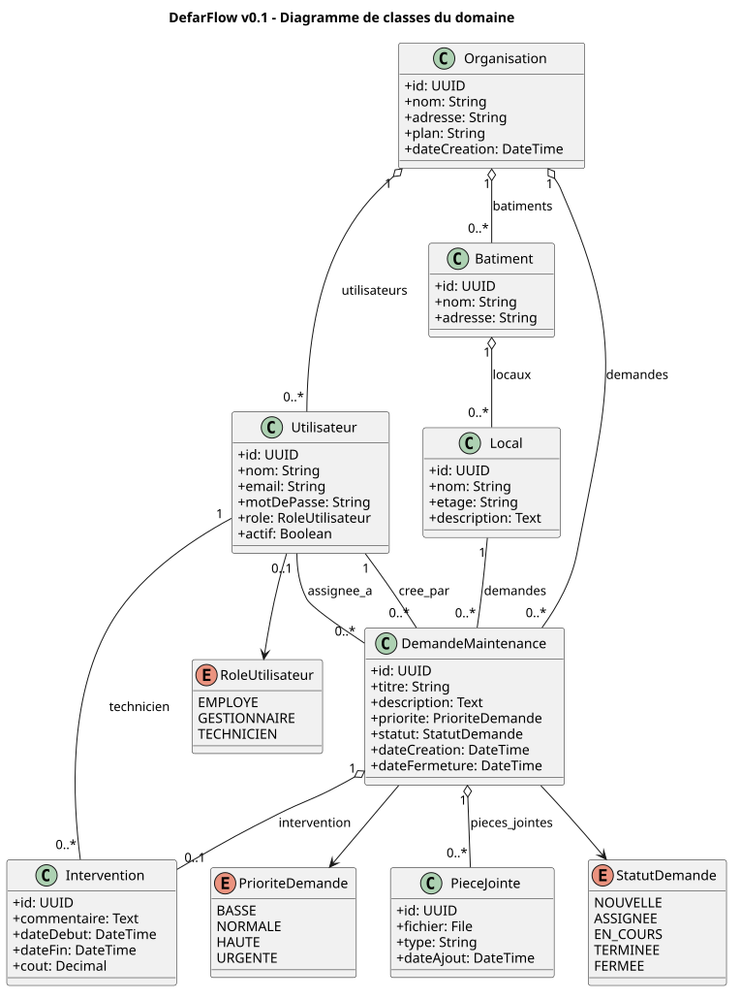
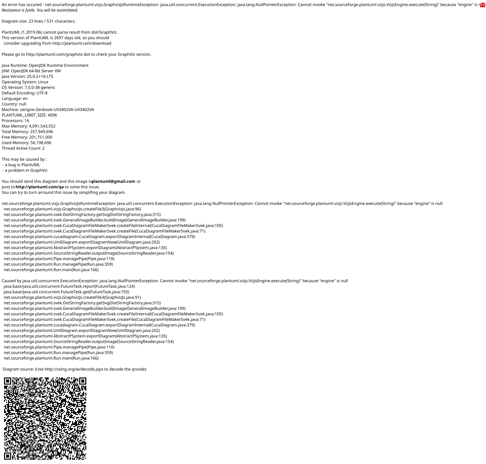
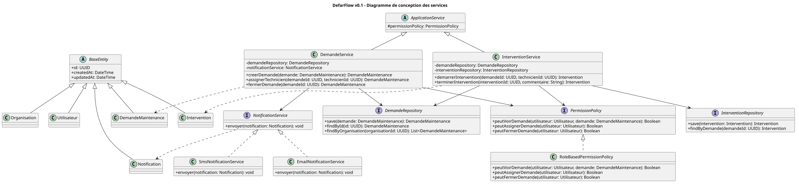

# DefarFlow v0.1 - Modele de domaine

## Diagramme UML

Source PlantUML: [docs/uml/domain-class-diagram.puml](uml/domain-class-diagram.puml)

Version SVG generee:
[docs/uml/rendered/domain-class-diagram.svg](uml/rendered/domain-class-diagram.svg)



Le cycle de vie d'une demande est modelise dans:
[docs/uml/request-state-diagram.puml](uml/request-state-diagram.puml)



Le diagramme de conception des services, avec classes abstraites et interfaces,
est separe du modele de domaine:
[docs/uml/service-class-diagram.puml](uml/service-class-diagram.puml)



## Choix de conception pour le MVP

Pour le backend Django, on utilisera probablement un seul modele `User` avec un
champ `role`, plutot que trois tables separees `Employe`, `Gestionnaire` et
`Technicien`.

Raison:

- plus simple a implementer
- plus naturel avec Django
- plus facile pour l'authentification
- suffisant pour la v0.1

Les concepts `Employe`, `Gestionnaire` et `Technicien` resteront des roles
metier. On pourra les representer dans les services, permissions et interfaces.

## Interfaces et classes abstraites

Les interfaces ne sont pas placees directement dans le diagramme de domaine,
car elles representent surtout des contrats techniques ou applicatifs.

Dans DefarFlow v0.1, elles sont modelisees dans le diagramme de conception des
services:

- `NotificationService`
- `DemandeRepository`
- `InterventionRepository`
- `PermissionPolicy`

Les classes abstraites initiales sont:

- `BaseEntity`, pour factoriser les champs communs des entites
- `ApplicationService`, pour factoriser les dependances communes des services

## Enums

### Role utilisateur

```text
EMPLOYE
GESTIONNAIRE
TECHNICIEN
```

### Statut demande

```text
NOUVELLE
ASSIGNEE
EN_COURS
TERMINEE
FERMEE
```

### Priorite demande

```text
BASSE
NORMALE
HAUTE
URGENTE
```

## Regles metier initiales

- Un utilisateur appartient a une seule organisation dans la v0.1.
- Une demande appartient toujours a une organisation.
- Une demande doit etre liee a un local.
- Une demande peut exister sans technicien assigne.
- Une demande fermee ne peut plus etre modifiee par un employe ou un technicien.
- Un technicien ne voit que les demandes qui lui sont assignees.
- Un employe ne voit que les demandes qu'il a creees.
- Un gestionnaire voit toutes les demandes de son organisation.

